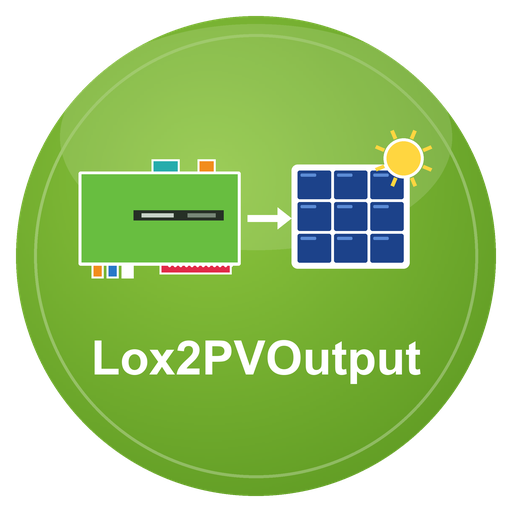

# Lox2PVOutput – LoxBerry-Plugin

**Version 0.5.0** · Benötigt LoxBerry 4 (PHP ≥ 8.4) · [Changelog](CHANGELOG.md)

Dokumentation: [docs/wiki/Home.md](docs/wiki/Home.md)

Liest Messwerte aus MQTT-Topics (z. B. von Senec2Lox, über den LoxBerry-Broker auch Werte aus dem Miniserver) und lädt sie alle 5/10/15 Minuten zu **pvoutput.org** hoch. Ersetzt den ioBroker-Adapter `pvoutputorg`.

## Installation
1. `bash build.sh` → `lox2pvoutput-<version>.zip` (oder ZIP von den Releases)
2. In LoxBerry → Plugin-Verwaltung → ZIP installieren.
3. Plugin öffnen, Reiter „Einstellungen“: API-Key und System-ID von pvoutput.org eintragen, Topics der Messwerte prüfen, „Werte an pvoutput.org senden“ aktivieren, speichern.
4. Reiter „Test“ → „PVOutput-Zugang prüfen“ und „Selbstprüfung“.

**Immer das neueste Release:** `https://github.com/ricten/Lox2PVOutput/releases/latest/download/lox2pvoutput.zip` (ZIP ohne Version im Namen). **Automatische Updates:** Neue Installationen stehen in der Plugin-Verwaltung auf „Releases“, LoxBerry prüft täglich die `release.cfg` im Repository und installiert neuere Versionen selbst (Details: [docs/wiki/Installation.md](docs/wiki/Installation.md)).

## Felder
| PVOutput | Bedeutung | Quelle |
|---|---|---|
| v2 / v4 | Erzeugung / Verbrauch Leistung (W) | Quelle aus der Liste (× Faktor) |
| v1 / v3 | Erzeugung / Verbrauch Energie (Wh seit Mitternacht) | aus der Leistung berechnet (Standard), Tageswert (z. B. Fronius „Erzeugung heute“) oder Gesamtzähler |
| v5 / v6 | Temperatur / Spannung | Quelle aus der Liste |
| v7–v12 | erweiterte Werte (nur mit Spenden-Konto) | Quelle aus der Liste |

Bei jedem Feld wählt man in einer Liste, woher der Wert kommt: **Fronius2Lox**, **Senec2Lox**, ein eigenes MQTT-Topic oder „nicht senden“ (Standard: Senec2Lox, v2 PV-Leistung, v4 Hausverbrauch). Details: [docs/wiki/Konfiguration.md](docs/wiki/Konfiguration.md).

## Topics des Plugins
`pvoutput/status/ok|zaehler|ts`, `pvoutput/upload/ok|ts|meldung`, `pvoutput/energie/erzeugung_wh|verbrauch_wh`. Vollständige Liste: [docs/wiki/MQTT-Topics.md](docs/wiki/MQTT-Topics.md).

## MQTT-Broker
Standard ist der Broker des LoxBerry (Zugangsdaten verwaltet LoxBerry). Alternativ lässt sich im Reiter „MQTT“ ein eigener Broker eintragen.

## Entwicklung
- Tests: `php tests/run.php`
- Details und Regeln: [CLAUDE.md](CLAUDE.md), [docs/wiki/Entwicklung.md](docs/wiki/Entwicklung.md)

## Lizenz
MIT, siehe [LICENSE](LICENSE). pvoutput.org ist ein Dienst von Dritten; dieses Plugin ist inoffiziell.
